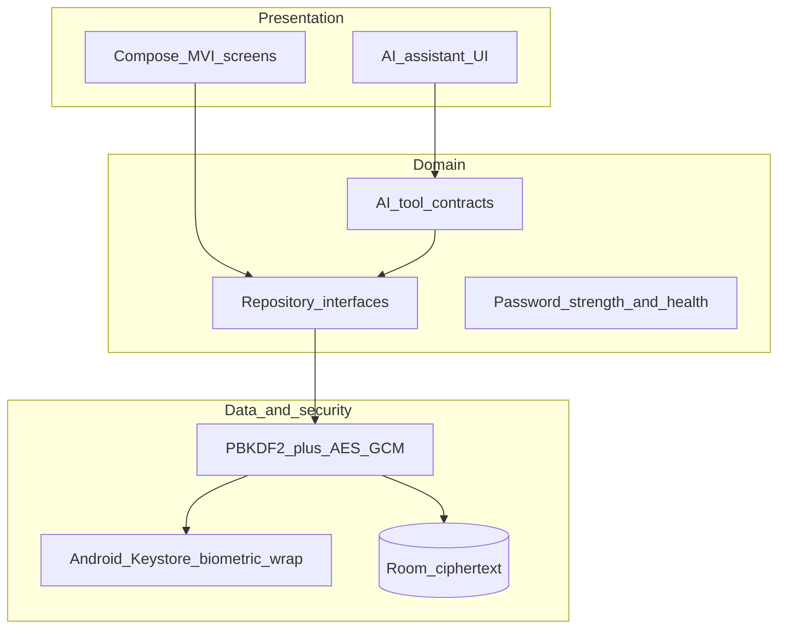
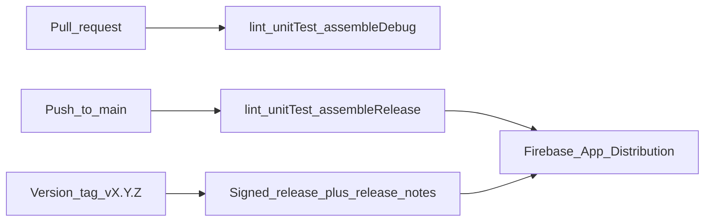

# Vaultly production delivery plan

> Build Vaultly as a production Android vault app: public GitHub repo, a new Firebase project (`vaultly-app`) on your account, GitHub Actions CI, and Firebase App Distribution for signed releases. Vault data stays encrypted on-device; Firebase is used for crash reporting and distribution, not as the password store.

## Feature Summary

Ship **Vaultly** (AI-powered privacy vault) as a deployable Android app, not a prototype.

**Confirmed decisions**

- New Firebase project ID: `vaultly-app` (display name Vaultly). If that ID is taken, we pick the next available `vaultly-app-<suffix>` with your OK.
- Distribution: **Firebase App Distribution only** (no Play Console in MVP).
- Source: **new public GitHub repo** named `Vaultly` under your GitHub account.
- Product requirements: the Vaultly spec you provided (local encrypted vault, master password + biometrics, notes, health, local-first AI tools, themes, backup/restore).

**Confirmed from the workspace** (`/Users/lokesh.ishwar/AndroidStudioProjects/NotesX`)

- Folder is still the NotesX Android Studio template plus a partial Vaultly Gradle scaffold (`:core:*`, `:feature:*`, `:build-logic`). **Not a git repo yet.**
- Intended applicationId: `com.anywhere.vaultly`.

Firebase will **not** hold passwords or notes. That matches the spec’s privacy-first model. Firebase is for Android app identity, Crashlytics (sanitized), and App Distribution.

## Open Questions

None blocking the plan. These can be decided during implementation without changing architecture:

- App Distribution testers: your Google account only vs a named tester group (emails).
- If `vaultly-app` is already taken globally, the exact fallback project ID.
- Optional later: Gemini / Firebase AI Logic for richer chat. MVP AI will be a **local tool orchestrator** so demo and offline work without sending vault contents to a cloud model.

## Feasibility

- **GitHub + Actions:** standard for public Android repos. You will need to authorize `gh` once if not already logged in.
- **Firebase on your account:** create project, register Android app `com.anywhere.vaultly`, download `google-services.json`, enable Crashlytics + App Distribution.
- **CI signing:** App Distribution still needs a **release keystore** in GitHub Actions secrets so testers get a stable, installable APK/AAB.
- **Instrumented UI tests on CI:** possible with an emulator, but slower/flaky. PRs will run unit tests + lint + assemble; emulator UI tests run on `main` (or nightly) so PRs stay fast.
- **Privacy vs Crashlytics:** Crashlytics is compatible if we never log master passwords, vault secrets, usernames, or note bodies (spec §54).

## Impact on Existing System

- Replaces NotesX template branding (namespace, app name, launcher, theme).
- Partial modules already listed in [`settings.gradle.kts`](settings.gradle.kts) become the real app; leftover `com.anywhere.notesx` sources are removed.
- First `git init` + public remote happens in this project directory (or we keep the folder name NotesX locally and the GitHub repo is `Vaultly`).

## Proposed Approach

### 1. Product architecture (on-device vault)

- Modular Gradle: `:app`, `:core:domain|security|database|data|presentation|design-system`, feature presentation modules (already sketched).
- Master password is never stored. KDF → in-memory DEK → encrypt fields at rest. Biometric unlock wraps DEK in Keystore. Auto-lock clears DEK.
- AI talks only to typed tools (`searchVault`, `generatePassword`, `createNote`, …) with confirmation for write/destructive actions. No dumping the vault into a prompt.
- Offline: all core vault actions. AI works locally; cloud LLM is a later optional adapter.

### 2. Firebase on your account (not a data backend)

Create and wire:

- Firebase project `vaultly-app`
- Android app: package `com.anywhere.vaultly`, nickname Vaultly
- SHA-1/SHA-256 of the **CI release keystore** (needed for some Firebase features; we register them after keystore generation)
- `google-services.json` in `:app` (this file is not a secret; still no API keys for vault crypto)
- **Crashlytics** + mapping file upload on release
- **App Distribution** with a `internal` tester group
- Explicitly **skip** Firebase Auth, Firestore, and Hosting for MVP (would fight the local-encryption model)

### 3. GitHub

- `git init`, root `.gitignore` (already has `/build`, `local.properties`; keep keystores and service accounts out)
- Create public repo `Vaultly` with `gh repo create`
- Default branch `main`
- Branch protection (after first successful CI): require `CI` check on PRs
- README: product positioning, how to build, how testers install from App Distribution, threat model (local encryption, what Firebase sees)

### 4. Production CI/CD

**PR workflow** (`.github/workflows/ci.yml`)

- JDK 17, Gradle wrapper cache
- `./gradlew detekt` or Android lint + `:app:assembleDebug` + `./gradlew test`
- Fail the job on test or lint errors

**Release workflow** (`.github/workflows/distribute.yml`)

- Trigger: push to `main` and tags `v*`
- Decode keystore from `SIGNING_KEYSTORE_BASE64`
- `./gradlew :app:assembleRelease`
- Upload Crashlytics mapping (if minification later; MVP can ship unminified first, then enable R8)
- `firebase appdistribution:distribute` via service account secret `FIREBASE_SERVICE_ACCOUNT`
- Artifact: APK (simpler for testers) plus optional AAB stored as GitHub Actions artifact

**GitHub secrets you will add once (I will generate the keystore locally, you store the secret; I will not commit it)**

- `SIGNING_KEYSTORE_BASE64`
- `SIGNING_KEY_ALIAS`
- `SIGNING_KEY_PASSWORD`
- `SIGNING_STORE_PASSWORD`
- `FIREBASE_SERVICE_ACCOUNT` (JSON of a Firebase/Google Cloud service account with App Distribution + Crashlytics upload roles)
- `FIREBASE_APP_ID` (from the Android app in Firebase console)

### 5. Implementation order after you approve this plan

1. Finish Gradle/modules, Application class, Koin, type-safe navigation shell.
2. Security + encrypted persistence + create/unlock/lock/biometric/auto-lock.
3. Passwords, generator, strength, notes, search, categories/tags/favorites, vault health.
4. Settings (theme, clipboard timeout, auto-lock, backup/export-import), screen privacy (`FLAG_SECURE`).
5. AI assistant UI + tool registry + confirmation dialogs.
6. Unit tests for crypto, generator, strength, tools; Compose tests for create-vault → unlock → add password.
7. Firebase SDK + Crashlytics sanitization + GitHub repo + Actions + first App Distribution upload.
8. You install from the email/link, we fix whatever fails (`you run/validate` on device; I fix CI and code).

## Dependencies

- Your GitHub login (`gh auth`) to create the public repo.
- Your Firebase login (Firebase MCP / `npx -y firebase-tools@latest`) to create `vaultly-app`.
- A Google Cloud service account for CI (created in that Firebase project).
- Android SDK / Gradle 9 already in the project.
- No Play Console, no backend server, no subscription stack.

## Edge Cases / Risks

- **`vaultly-app` ID collision** — create with a suffix; app ID `com.anywhere.vaultly` is independent.
- **Public repo + secrets** — never commit `local.properties`, keystore, or service account JSON. Add `gitleaks` or a secret-scan step in CI.
- **App Distribution signing mismatch** — testers cannot update if the signing key changes; generate one keystore and keep it only in secrets/backup.
- **Crashlytics leaking vault data** — disable automatic logging of screen content; custom keys only for non-PII (theme, vault-created true/false, never counts of named accounts).
- **Emulator UI tests** — treat as best-effort on `main`; do not block every PR if the emulator image fails to boot.
- **AI cloud APIs** — out of MVP to avoid sending secrets off-device.

## Effort & Timeline

- Infra (repo, Firebase, CI, signing, first empty/signed shell on App Distribution): first slice.
- Full MVP features + tests + Crashlytics sanitization: main build.
- Stabilize from your device/App Distribution feedback: last slice.

No false hour estimates; this is a full product, not a weekend tweak. Work proceeds in the slices above so you get a GitHub URL and a tester link before every screen is done.

## Rollout Plan

1. **Internal:** you as the only App Distribution tester; debug/release from `main`.
2. **Demo:** tagged `v0.1.0` with release notes covering vault + AI demo script from the spec.
3. **Later (out of this plan):** Play Internal testing, iOS, encrypted cloud sync.
